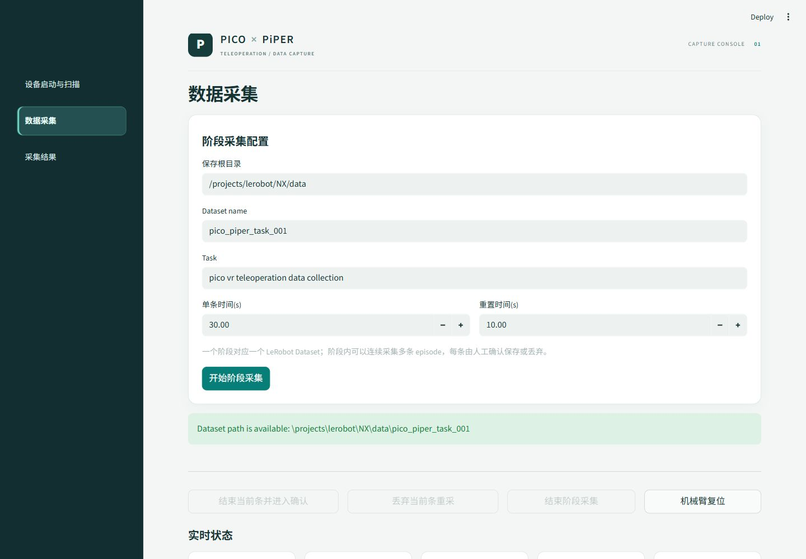

# Pico × PiPER

基于 Pico VR 的松灵 PiPER 双臂遥操与 LeRobot 数据采集项目，包含 ROS 2 桥接、三相机采集和 Streamlit 操作界面。

[English](README.md) · [安装说明](docs/INSTALL.md) · [系统结构](docs/ARCHITECTURE.md) · [第三方许可](THIRD_PARTY_NOTICES.md)



离线界面预览，未连接机械臂和相机。

## 功能

- Pico 手柄输入，经 IK 求解和 ROS 2 控制松灵 PiPER 双臂。
- 采集左右臂关节、末端位姿、夹爪、VR 输入及顶部／左右腕三路图像。
- 通过共享逻辑帧时间对齐 observation 和 action，按 30 Hz 保存 LeRobot 数据。
- 网页完成设备启动与扫描、阶段采集、逐条保存／丢弃／重采、环境重置等待和数据集检查。“机械臂复位”按钮保留原有占位行为，只提示尚未实现，不发送复位指令。

一个阶段对应一个 Dataset，可以包含多条 episode。原流程为：**倒计时 → 录制 → 环境重置等待 → 人工确认 → 保存／丢弃／继续／结束**。松开手柄时继续使用原来的反馈 hold 语义，LeRobot 的 `send_action` 保持 no-op，机械臂由原 ROS 遥操链路驱动。

本次发布调整了视觉样式和仓库组织，保留采集状态机、录制时序、话题、数据字段、机械臂指令及 IK 计算。清除的 `arm_interfaces` 仅是未使用的历史头文件与构建依赖；松灵实际驱动及 `agx_arm_msgs` 均保留。

## 使用环境

完整系统需要 Linux x86_64、ROS 2 Humble、Pico/XRoboToolkit PC Service 与 SDK、松灵机械臂及 CAN、三路 USB 相机和原生 IK 依赖。LeRobot 采集环境使用 Python 3.12；ROS 桥接使用 ROS 对应的系统 Python。源码保留 `/projects` 容器内目录约定，避免改变现有控制链路的路径。

具体安装及启动命令见 [docs/INSTALL.md](docs/INSTALL.md)。首次使用时复制 `camera_config.example.json` 为本地 `camera_config.json`，通过设备页配置自己的相机路径。已有部署保留自己的本地配置即可。

页面采用深色侧栏、浅色内容区与蓝绿色强调色。按钮、输入项及保存确认流程沿用原有实现。

## 发布范围

仓库提供应用、桥接与插件、ROS 源码、机器人模型和必要的上游源码快照。Docker 镜像备份、SDK 安装包、编译产物、采集数据、模型权重和原机器相机标识不进入 Git。

```bash
python -m pip install -r requirements-dev.txt
python scripts/check_release.py
python -m pytest tests -q
```

离线验证不会驱动机械臂，不能替代实际设备联调。贡献方式见 [CONTRIBUTING.md](CONTRIBUTING.md)。集成与主题代码采用 Apache-2.0，上游组件保留各自原许可，详见 [THIRD_PARTY_NOTICES.md](THIRD_PARTY_NOTICES.md)。
