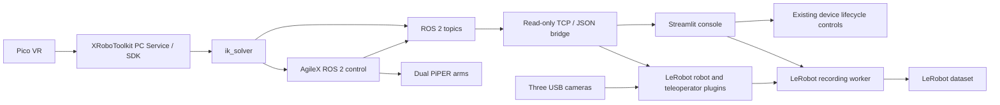

# Architecture and behavior boundaries

## Runtime separation

The ROS bridge subscribes to XR input, feedback, gripper status, and control-target topics. It buffers received samples using monotonic timestamps and responds to `ping`, `health`, and `snapshot` JSON-line requests on `127.0.0.1:8765`. It has no motion-command endpoint. Timestamped selection and recorded ages allow stale data to be identified; this does not guarantee hardware clock synchronization.

The robot and teleoperator plugins share logical frame context. Their 14 action values are left six joints and gripper, then right six joints and gripper. Fresh IK targets are preferred; fresh feedback provides the existing hold fallback. The robot plugin deliberately leaves direct LeRobot arm actuation disabled.

The original recorder owns timing, episode decisions, video encoding, and dataset finalization. One dataset can contain many episodes. The UI blocks new stages until finalization has completed and refuses existing dataset paths.

## Visual changes

`console_theme.py`, `console.css`, and `.streamlit/config.toml` provide styling. `app.py` calls the theme before running the original navigation. Page widget labels, callback wiring, runtime services, robot APIs, and dataset schema are unchanged. Styling does not hide device warnings or change the enabled/disabled state of controls.

## Packaging changes

- Hardware-specific camera IDs are removed from defaults and supplied through an ignored local configuration file using the original resolver.
- The otherwise unused `arm_interfaces` includes and build declarations are removed. No message in that package was referenced by the IK implementation. AgileX's `agx_arm_msgs` remains included.
- XR message schemas are unchanged and match the upstream version recorded in `THIRD_PARTY_NOTICES.md`.
- Upstream code is retained as source snapshots to avoid silently changing recording APIs or robot model versions during installation.
- `/projects` remains the reference mount path. The PC Service installation path remains `/opt/apps/roboticsservice`.

`docs/behavior-baseline.sha256.json` records hashes of the preserved behavior-bearing files. `scripts/check_release.py` verifies these alongside public-release hygiene. This verifies preservation, not hardware correctness.
