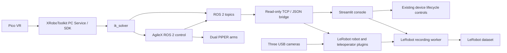

# Architecture and source map

## Runtime separation

The ROS bridge runs with ROS system Python, while Streamlit, LeRobot and both plugins run in the Python 3.12 collection environment. They communicate through newline-delimited JSON on `127.0.0.1:8765`. The bridge supports `ping`, `health` and `snapshot`; it exposes no motion-command endpoint. The console's process controls can separately start or stop the ROS control chain.

The bridge subscribes to 11 topics:

| ROS topic | Message type | Use |
| --- | --- | --- |
| `/xr_pose` | `xr_msgs/Custom` | Head/controller input |
| `/left/feedback/joint_states`, `/right/feedback/joint_states` | `sensor_msgs/JointState` | Measured joints |
| `/left/feedback/tcp_pose`, `/right/feedback/tcp_pose` | `geometry_msgs/PoseStamped` | Measured TCP pose |
| `/left/feedback/gripper_status`, `/right/feedback/gripper_status` | `agx_arm_msgs/GripperStatus` | Gripper feedback |
| `/left/control/move_j`, `/right/control/move_j` | `sensor_msgs/JointState` | IK joint targets |
| `/left/control/joint_states`, `/right/control/joint_states` | `sensor_msgs/JointState` | Gripper control values |

`TopicStore.latest_before()` selects the newest sample received at or before the requested monotonic frame time. If none qualifies, it falls back to the newest buffered sample, which can produce a negative age. `source_stamp_ns` is retained separately; selection uses the host's **receive** clock. This is not hardware clock synchronization or a strict guarantee that all samples predate the frame. The standalone bridge defaults to 600 samples per topic; the UI launcher explicitly selects 900.

`snapshot.ok` indicates that the bridge handled the request. A source's `valid` means a sample was received, not that it is fresh. Source ages and the plugin's quality flags must be inspected separately.

## Observations and actions

The robot observation establishes a logical frame time and bridge snapshot in shared module-level context protected by a lock. The teleoperator reuses that context. `OBS_KEYS` contains joints, TCP poses, gripper feedback, XR input, timing, validity and recovery diagnostics; the robot also returns three RGB images. `ACTION_KEYS` defines 14 values: left joints 1–6, left gripper, right joints 1–6, right gripper. See [pico_piper.py](../lerobot_robot_pico_piper/lerobot_robot_pico_piper/pico_piper.py).

In [PicoVr._fill_side_action()](../lerobot_teleoperator_pico_vr/lerobot_teleoperator_pico_vr/pico_vr.py), each arm independently uses a valid six-joint `control/move_j` sample with age ≤500 ms, otherwise attempts the joint-feedback sample. Grippers independently use a control sample with age ≤500 ms, otherwise gripper feedback. Feedback fallbacks do **not** check feedback age; missing usable fields retain zero values. A bridge request exception uses the last computed action for up to 500 ms, then zeros. These are recorded values; `PicoPiper.send_action()` remains a no-op and the ROS chain drives the physical arms.

Controller release is not an action-selection condition. Fresh IK targets can remain selected until their age limit. `left/right_control_active` is a diagnostic derived from VR freshness and controller grip, not a gate on recorded actions.

The robot computes `*_action_from_ik`, `*_action_from_hold` and `*_action_semantic_valid` from source ages. Hold availability uses joint-feedback age ≤100 ms. These markers do not verify all action payload fields or gripper freshness and are not a motion interlock. Distinguish diagnostic age checks from the teleoperator's actual fallback selection.

## Timing and recording

| Setting | Current implementation |
| --- | --- |
| Recording target | 30 Hz; `loop_dt_ms` and `schedule_lag_ms` are logical scheduling diagnostics |
| Recording camera request | Three cameras, 640 × 480, 30 fps, MJPG input; RGB observations |
| Idle preview output | 320 × 240, loop target 20 Hz; camera request 640 × 480 at 30 fps |
| Browser live-panel refresh | Streamlit fragments every 0.5 s on device and collection pages |
| Freshness defaults | Camera ≤80 ms, ROS feedback ≤100 ms, XR/IK targets ≤500 ms |
| Video defaults | H.264, video enabled, streaming encoding disabled |
| Remote dataset upload | `push_to_hub=False` in the UI recording path |

Camera capture, preview processing, recording, and browser refresh are separate rates. A requested rate is not a measured throughput guarantee. `loop_dt_ms` measures differences between logical frame times, resets to zero on schedule realignment, and is not wall-clock loop duration. `schedule_lag_ms` is measured before bridge/camera processing; long delays can be hidden by realignment. These diagnostics cannot establish actual throughput; compare saved frame counts with independently measured recording time when evaluating it. The plugin's diagnostic `frame_index` resets on connection and also advances during reset loops; it is not the dataset's per-episode frame index.

The recorder owns episode decisions, video encoding and finalization. One stage creates one new dataset and can append multiple saved episodes. The flow is countdown → record → operator reset wait → save/discard decision. Reset runs without a dataset writer and does not home or pause the arms. The UI refuses existing dataset paths and waits for finalization and worker cleanup before permitting another stage. See the [operation guide](OPERATIONS.md).

## Source map

| Responsibility | Implementation |
| --- | --- |
| Navigation and presentation | [app.py](../pico_piper_streamlit_app/app.py), [console_theme.py](../pico_piper_streamlit_app/console_theme.py), [console.css](../pico_piper_streamlit_app/console.css) |
| Device controls and preview panel | [1_Device_Setup.py](../pico_piper_streamlit_app/pages/1_Device_Setup.py) |
| Collection controls and quality verdict | [2_Data_Collection.py](../pico_piper_streamlit_app/pages/2_Data_Collection.py) |
| Results display and limited checks | [3_Collection_Results.py](../pico_piper_streamlit_app/pages/3_Collection_Results.py), [dataset_validate.py](../pico_piper_streamlit_app/dataset_validate.py) |
| Startup/shutdown/recovery | [runtime.py](../pico_piper_streamlit_app/runtime.py), [process_manager.py](../pico_piper_streamlit_app/process_manager.py) |
| Camera binding and idle capture | [camera_config.py](../pico_piper_streamlit_app/camera_config.py), [camera_preview.py](../pico_piper_streamlit_app/camera_preview.py) |
| Scan gates | [device_scan.py](../pico_piper_streamlit_app/device_scan.py) |
| Recording state and defaults | [recorder.py](../pico_piper_streamlit_app/recorder.py) |
| ROS subscriptions and JSON protocol | [ros2_pico_piper_bridge.py](../lerobot_robot_pico_piper/scripts/ros2_pico_piper_bridge.py) |
| Logical frame context and camera sampling | [shared_timing.py](../lerobot_robot_pico_piper/lerobot_robot_pico_piper/shared_timing.py), [threaded_camera.py](../lerobot_robot_pico_piper/lerobot_robot_pico_piper/threaded_camera.py) |
| Observation schema and age defaults | [pico_piper.py](../lerobot_robot_pico_piper/lerobot_robot_pico_piper/pico_piper.py), [config_pico_piper.py](../lerobot_robot_pico_piper/lerobot_robot_pico_piper/config_pico_piper.py) |
| Action selection and cache default | [pico_vr.py](../lerobot_teleoperator_pico_vr/lerobot_teleoperator_pico_vr/pico_vr.py), [config_pico_vr.py](../lerobot_teleoperator_pico_vr/lerobot_teleoperator_pico_vr/config_pico_vr.py) |

## Release boundaries

The theme and explanatory copy can change without changing widget keys, callbacks, enabled states or recording/control logic. Camera serial/by-id identities are excluded; reference USB by-path strings remain and must be configured for each rig. The unused `arm_interfaces` includes and build declarations were removed; AgileX's `agx_arm_msgs` remains. XR message schemas match the upstream revision in [THIRD_PARTY_NOTICES.md](../THIRD_PARTY_NOTICES.md). Upstream components remain source snapshots.

[behavior-baseline.sha256.json](behavior-baseline.sha256.json) records normalized hashes of selected runtime files, checked by [check_release.py](../scripts/check_release.py). It is an integrity guard, not a hardware test or proof that every file in the repository has identical behavior. Page hashes were refreshed for the documentation-alignment change's display-text-only edits; recorder, plugins, bridge and IK behavior baselines remain unchanged.
